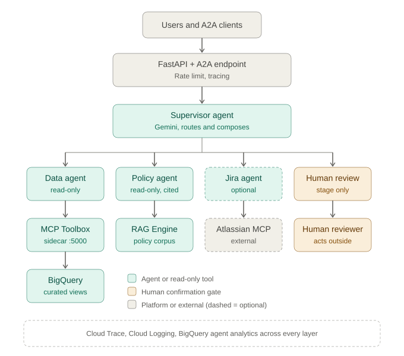
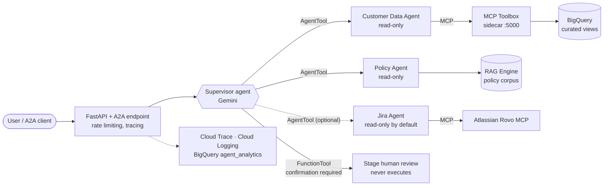
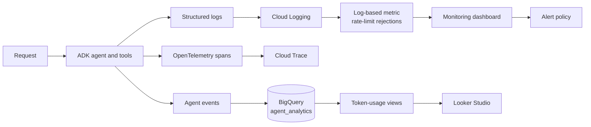

# Enterprise Agentic ERP on Google Cloud

A governed, multi-agent **Customer Operations assistant** for ERP workflows, built on the Google Agent Development Kit (ADK) and deployed on Google Cloud. A supervisor agent routes each request to scoped, read-only specialists for customer data, policy retrieval (RAG), and Jira. Anything sensitive is staged for a human and never executed by the agent.

> All data is **synthetic**. The project is a reference implementation of safe, observable, production-shaped agent engineering, not a production system.


---

## What it does

| Capability | How it is delivered |
| :--- | :--- |
| Look up a customer, recent orders, and open support tickets | Customer Data Agent, through an **MCP Toolbox** server exposing three parameterized, read-only BigQuery tools |
| Answer returns, refund, privacy, and escalation questions with citations | Policy Agent, through **Agent Platform RAG Engine** with source-file citations |
| Query Jira issues (optional) | Jira Agent, through the **Atlassian Rovo MCP** server. Disabled by default, and writes need explicit enablement plus human confirmation |
| Handle sensitive requests (refund, payment change, account closure, privileged export, Jira write) | Supervisor stages a **human-review request** behind an ADK confirmation gate. The business action is never executed |
| Run as a service | FastAPI + A2A JSON-RPC, packaged in a non-root container, deployed to **Cloud Run** and **GKE** |
| Be operable | Cloud Trace, Cloud Logging, BigQuery Agent Analytics, rate limiting, log-based metric, dashboard, and alert |

## Architecture at a glance



The same view as an editable Mermaid diagram:



Deeper diagrams (request sequence, human-in-the-loop flow, deployment topologies, data pipeline, security layers, observability) are in **[docs/architecture.md](docs/architecture.md)**.

## Key design principles

1. **Least privilege per agent.** Each specialist sees only the tools it needs. The data agent cannot search policies, and the policy agent cannot read customer data.
2. **Read-only by construction.** The Toolbox runs with `writeMode: blocked`, a dataset allowlist, a row cap, and a 100 MiB billing cap. There is no free-form SQL tool.
3. **Humans approve consequential actions.** The staging tool returns `action_executed: false` and `authorized_human_approval: false` every time.
4. **Retrieved content is untrusted.** Policy text and Jira content are treated as data, never as instructions, which mitigates prompt injection.
5. **Evidence over invention.** Answers carry source citations. If evidence is missing, the agent says so.
6. **Observable by default.** Every agent step, tool call, token count, and rate-limit rejection is traceable without logging sensitive content.

Full details: **[docs/security-and-governance.md](docs/security-and-governance.md)** and **[docs/design-decisions.md](docs/design-decisions.md)**.

## Tech stack

| Layer | Technology |
| :--- | :--- |
| Agent framework | Google ADK (`google-adk` 2.6), Gemini on Vertex AI |
| Tool protocol | Model Context Protocol (MCP), MCP Toolbox for Databases 1.8.0 |
| Agent-to-agent | A2A protocol (`a2a-sdk`), `RemoteA2aAgent` |
| Grounding | Agent Platform RAG Engine |
| Data | BigQuery (`curated` views over CDC-replicated PostgreSQL data) |
| Serving | FastAPI, Uvicorn, Python 3.12, `uv` |
| Compute | Cloud Run (agent + Toolbox sidecar), GKE (Workload Identity) |
| Registry / build | Artifact Registry, Cloud Build |
| Observability | OpenTelemetry → Cloud Trace, Cloud Logging, BigQuery Agent Analytics, Cloud Monitoring |
| Conversational surface | Gemini Enterprise Agent Platform CX (GECX) app with prompt and safety guardrails |
| Quality | pytest unit and integration tests, LLM-as-judge evaluation datasets, Ruff |

## Repository layout

```text
agentic-erp-lab/
├── agents/customer-ops-agent/      # The ADK agent service
│   ├── app/
│   │   ├── agent.py                # Supervisor + AGENT_ROLE runtime modes
│   │   ├── specialist_agents.py    # Customer Data and Policy agents
│   │   ├── jira_agent.py           # Optional Jira specialist
│   │   ├── remote_agents.py        # A2A clients for distributed mode
│   │   ├── mcp_tools.py            # MCP Toolbox toolset
│   │   ├── rag_tools.py            # RAG Engine retrieval tool
│   │   ├── approval_tools.py       # Human-review staging tool
│   │   ├── analytics.py            # BigQuery Agent Analytics plugin
│   │   ├── rate_limit.py           # Sliding-window rate-limit middleware
│   │   ├── fast_api_app.py         # API server, A2A routes, telemetry
│   │   └── app_utils/              # A2A attachment, session/artifact services
│   ├── toolbox/                    # MCP Toolbox config + Dockerfile (sidecar)
│   ├── infra/gke/                  # Kubernetes manifest
│   ├── tests/                      # unit, integration, eval datasets
│   ├── artifacts/                  # evaluation results and traces
│   └── Dockerfile
├── gecx/customer-ops-agent/        # GECX app definition and guardrails
├── app/db/                         # PostgreSQL schema, seed, validation SQL
├── knowledge-base/customer-ops/    # Policy documents ingested into RAG
├── specs/                          # Project charter and data model
├── docs/                           # Architecture, governance, design decisions, day-by-day notes
└── AGENTS.md                       # Rules that govern AI agents in this repo
```

## Runtime modes

One codebase serves five shapes, selected with `AGENT_ROLE`:

| `AGENT_ROLE` | Behavior |
| :--- | :--- |
| `combined` (default) | Supervisor and specialists in one process |
| `customer_data` | Customer Data Agent only, as a standalone A2A service |
| `policy` | Policy Agent only, as a standalone A2A service |
| `jira` | Jira Agent only (needs `ATLASSIAN_MCP_ENABLED=true`) |
| `supervisor` | Supervisor calling remote specialists over A2A (agent-card URLs from env) |

## Quick start (local)

Requirements: Python 3.11–3.13, [`uv`](https://docs.astral.sh/uv/), Google Cloud SDK with Application Default Credentials, and `agents-cli`.

```bash
cd agents/customer-ops-agent
cp .env.example .env          # set GOOGLE_CLOUD_PROJECT and RAG_CORPUS_RESOURCE
agents-cli install            # uv sync

# Start the MCP Toolbox (read-only BigQuery tools) in another terminal
toolbox --config toolbox/tools.yaml --address 127.0.0.1 --port 5000

agents-cli playground         # interactive local UI
```

Run the checks:

```bash
uv run --extra lint ruff check app tests/unit
uv run pytest tests/unit tests/integration
agents-cli eval --help        # LLM-as-judge evaluation, datasets in tests/eval/datasets
```

Example prompts to try:

- *"Summarize customer `<customer-uuid>` and list their open tickets."* (data agent)
- *"What is the refund window and who approves refunds?"* (policy agent, with citations)
- *"Refund order `<order-id>`."* (refused, with an option to stage a human review)

## Deployment

| Target | Notes |
| :--- | :--- |
| **Cloud Run** | Private service, two containers (agent on `8080`, Toolbox sidecar on `5000`), dedicated runtime service account. See [docs/day-11-cheatsheet.md](docs/day-11-cheatsheet.md) |
| **GKE** | Namespace, Workload Identity-bound service account, probes, resource limits, `allowPrivilegeEscalation: false`, all capabilities dropped. Manifest at `agents/customer-ops-agent/infra/gke/customer-ops.yaml` |

Images are pinned by digest in the manifests.

## Observability



## Documentation map

| Document | Contents |
| :--- | :--- |
| [docs/architecture.md](docs/architecture.md) | System, component, sequence, deployment, data, and security diagrams |
| [docs/security-and-governance.md](docs/security-and-governance.md) | Threat model, control matrix, human-in-the-loop policy |
| [docs/design-decisions.md](docs/design-decisions.md) | Why each major choice was made, with trade-offs |
| [specs/project-charter.md](specs/project-charter.md) | Goals, scope, and use cases |
| [specs/data-model.md](specs/data-model.md) | Multi-tenant PostgreSQL model and ERD |
| [docs/day-8-cheatsheet.md](docs/day-8-cheatsheet.md) – [day-11](docs/day-11-cheatsheet.md) | Build notes: A2A orchestration, MCP and HITL, observability, Cloud Run |
| [AGENTS.md](AGENTS.md) | Rules for AI coding agents working in this repo |

## Known limitations and next steps

- The rate limiter is **in-memory and per instance**, and keys on the direct connection address. Behind a load balancer or proxy, move it to a shared store or an API gateway.
- The A2A task store is `InMemoryTaskStore`. Use a durable store for multi-replica deployments.
- Remote A2A authentication between supervisor and specialists is planned (see the production security plan in the Day 8 notes).
- CI/CD and Terraform are not yet in the repo. `agents-cli scaffold enhance` generates both.
- Evaluation datasets and results exist, but there is no automated quality gate yet.

## Security note

Never commit `.env` files, service-account keys, tokens, Terraform state, or database dumps. Use Application Default Credentials and least-privilege service identities. See [AGENTS.md](AGENTS.md).
