# Architecture

This document describes how the Customer Operations agent system is structured, how a request flows through it, and how it is deployed and observed. All diagrams are Mermaid and render on GitHub.

Contents: [1. System context](#1-system-context) · [2. Agent topology](#2-agent-topology) · [3. Request flow](#3-request-flow) · [4. Human-in-the-loop flow](#4-human-in-the-loop-flow) · [5. Runtime modes](#5-runtime-modes) · [6. Data architecture](#6-data-architecture) · [7. Deployment](#7-deployment) · [8. Observability](#8-observability) · [9. Security layers](#9-security-layers) · [10. Component reference](#10-component-reference)

---

## 1. System context

Overview as an editable Mermaid diagram, with the surrounding GCP services:

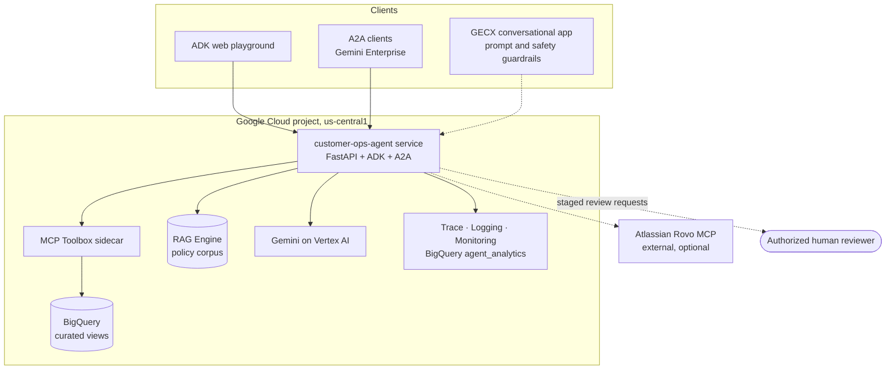

## 2. Agent topology

The supervisor exposes specialists to the model as **tools** (`AgentTool`), so the supervisor stays in control of the conversation and composes the final answer. Specialists are scoped by instruction and by tool set.

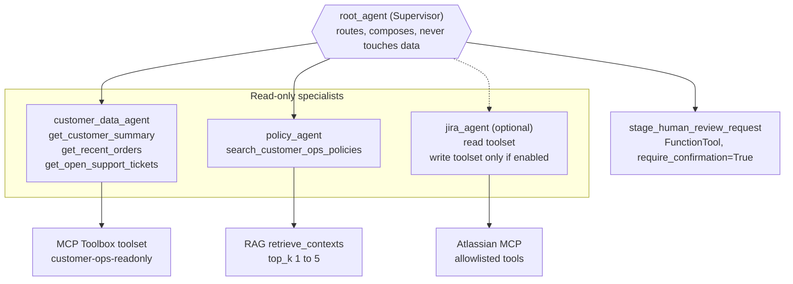

Routing rules enforced in the supervisor instruction:

| Request type | Routed to |
| :--- | :--- |
| Customer, order, or support-ticket lookup | `customer_data_agent` |
| Policy, privacy, returns, refunds, escalation | `policy_agent` |
| Jira issue, project, or search | `jira_agent` (when enabled) |
| Mixed request | Every required specialist, then one composed answer |
| Sensitive action the user wants reviewed | `stage_human_review_request` (after explaining it only stages) |
| Writes, refunds, account closure, exports, bypasses | Refused |

## 3. Request flow

A mixed request: *"What is customer X's latest order status, and can they still return it?"*

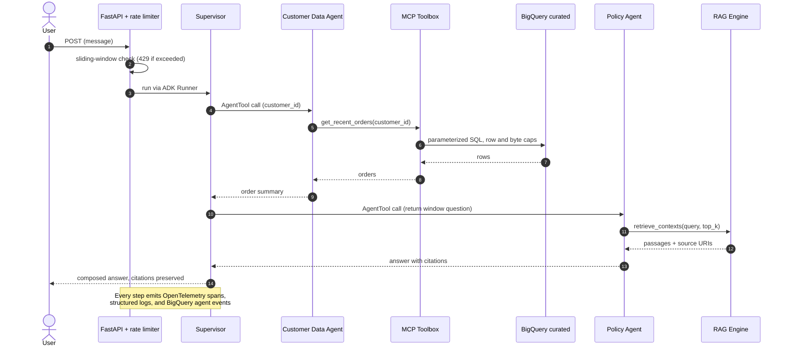

## 4. Human-in-the-loop flow

Sensitive actions are never executed by an agent. The agent can only **stage** a review request, and even staging pauses for explicit user confirmation.

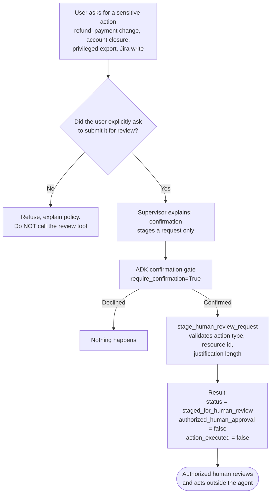

Jira writes follow the same principle: write tools exist only when `ATLASSIAN_MCP_WRITE_ENABLED` is set, the user must request the exact action, and ADK requires human confirmation of the tool call.

## 5. Runtime modes

One image, five shapes. `AGENT_ROLE` selects what `root_agent` is.

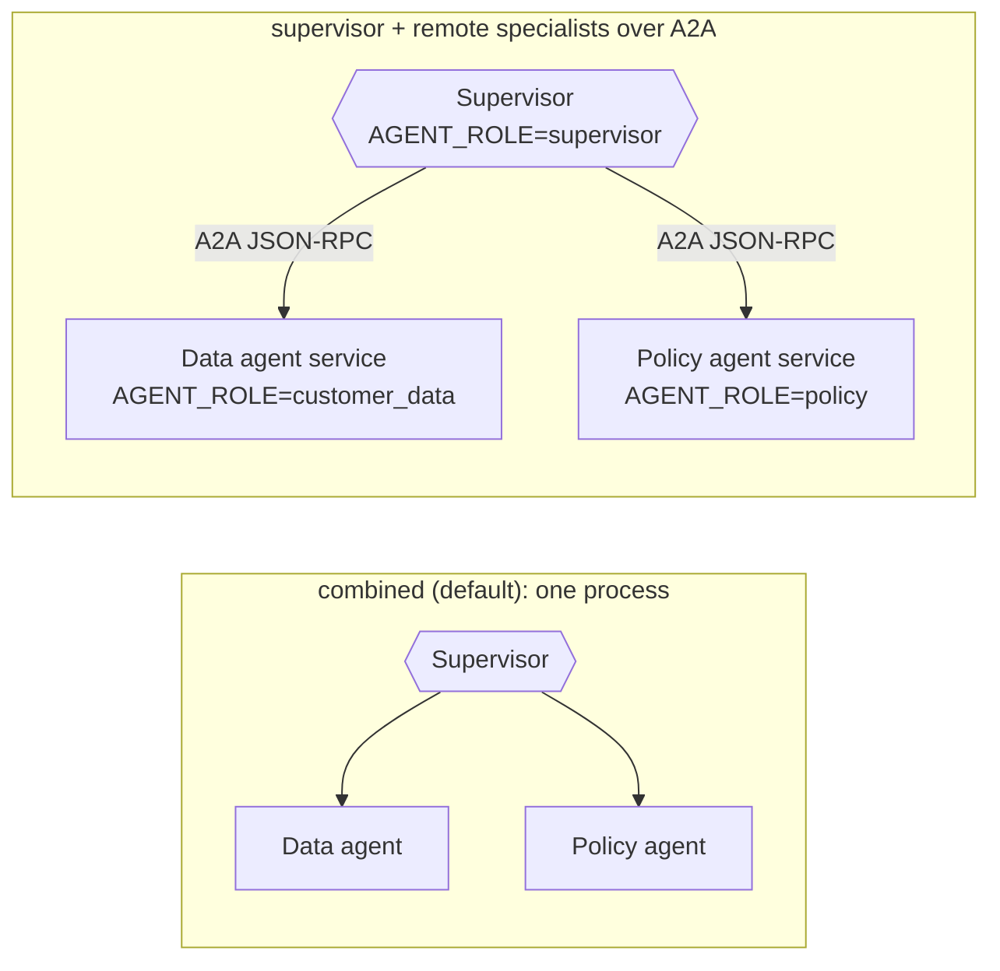

In distributed mode the supervisor discovers specialists from their **A2A agent cards** (`CUSTOMER_DATA_AGENT_CARD_URL`, `POLICY_AGENT_CARD_URL`). Each agent serves `/.well-known/agent-card.json` under `/a2a/<app>`, so specialists are independently deployable, scalable, and replaceable.

## 6. Data architecture

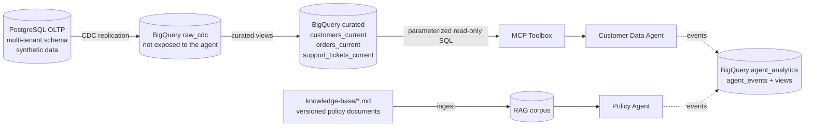

Boundaries that matter:

- The runtime identity can read **`curated`** only. It has no access to `raw_cdc`.
- The curated views mask sensitive fields (for example `shipping_address_masked`).
- Policy documents carry front matter (`document_id`, `version`, `effective_date`, `owner`) so citations are traceable.

### Transactional model

Ten tables, each with a UUID primary key and a `tenant_id` for tenant isolation. The `approval_requests` and `agent_action_audit` tables model the human-approval and audit trail the agent is designed to feed.

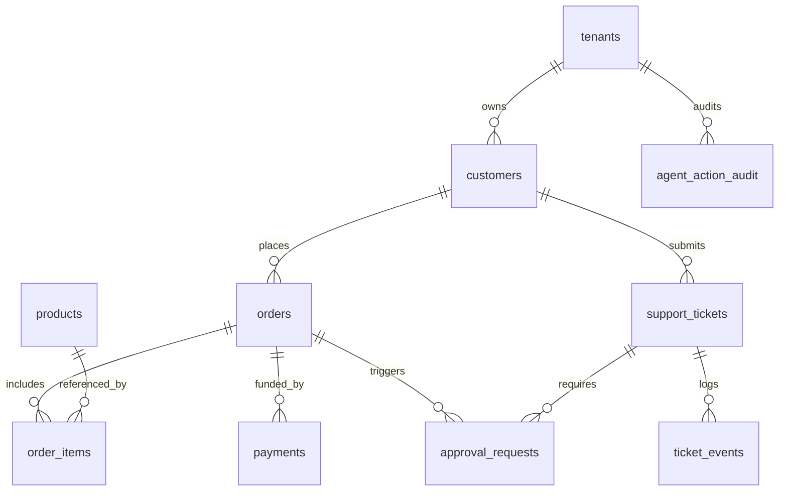

Column-level detail is in [specs/data-model.md](../specs/data-model.md).

## 7. Deployment

### Cloud Run (private service, two containers)

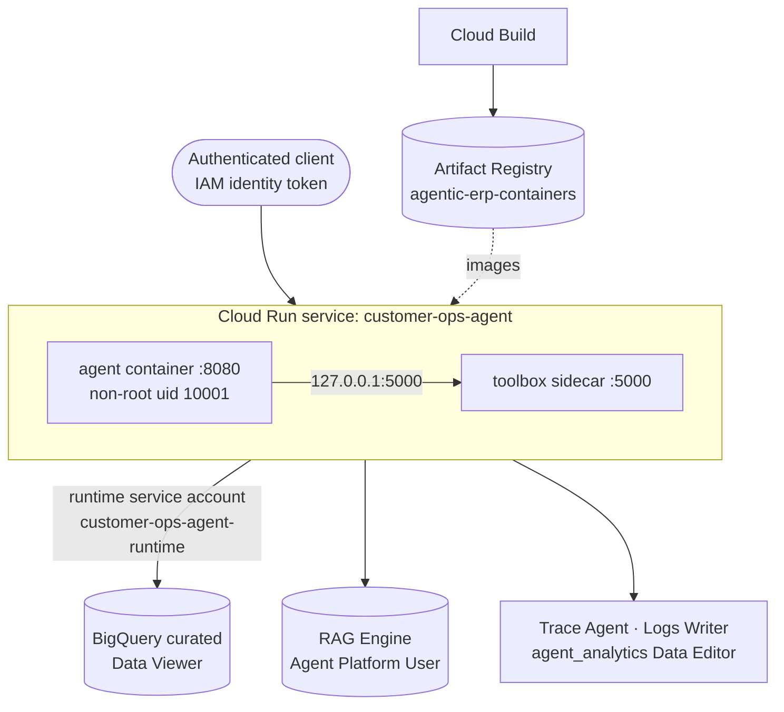

### GKE

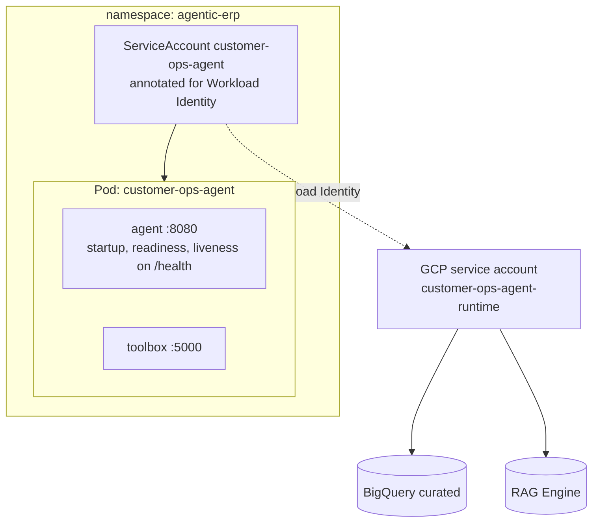

Hardening applied to both targets: non-root user, no privilege escalation, all Linux capabilities dropped, resource requests and limits, health probes, images pinned by digest, no keys in images (Application Default Credentials).

## 8. Observability

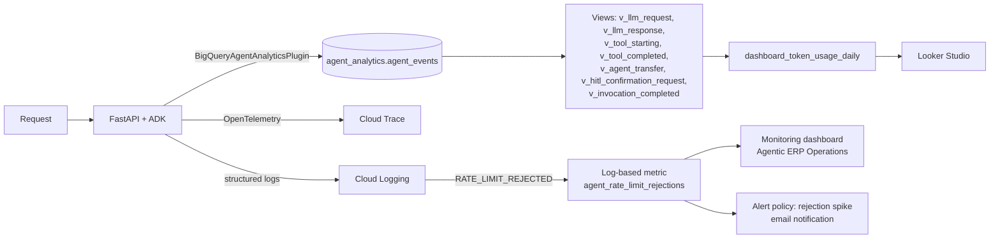

What is captured: token usage, latency, tool calls, HITL confirmation requests, errors, and rate-limit rejections. What is deliberately **not** captured: raw client addresses (logged as a 12-character SHA-256 prefix), multimodal content, and unbounded payloads (content is truncated at 64 KiB).

## 9. Security layers

Defense in depth: a failure in one layer is contained by the next.

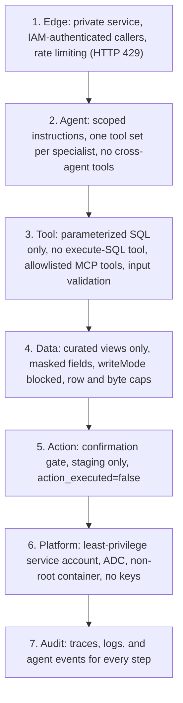

See [security-and-governance.md](security-and-governance.md) for the threat model and control matrix.

## 10. Component reference

| Component | File | Responsibility |
| :--- | :--- | :--- |
| Supervisor and modes | `app/agent.py` | Builds the supervisor, selects `AGENT_ROLE`, attaches analytics |
| Specialists | `app/specialist_agents.py` | Customer Data and Policy agents and their instructions |
| Jira specialist | `app/jira_agent.py`, `app/jira_mcp.py` | Optional Atlassian MCP agent; separate read and write toolsets |
| Remote agents | `app/remote_agents.py` | `RemoteA2aAgent` clients from agent-card URLs |
| MCP data access | `app/mcp_tools.py`, `toolbox/tools.yaml` | Toolbox client and the three read-only BigQuery tools |
| Direct BigQuery tools | `app/tools.py` | Original parameterized read-only functions, superseded by the Toolbox path |
| RAG retrieval | `app/rag_tools.py` | Validated query, bounded `top_k`, structured not-found and error results |
| Human review | `app/approval_tools.py` | Allowlisted action types, input validation, staging only |
| Telemetry | `app/analytics.py` | BigQuery Agent Analytics plugin configuration |
| Rate limiting | `app/rate_limit.py` | Sliding-window middleware with privacy-safe rejection logging |
| Server | `app/fast_api_app.py` | ADK FastAPI app, A2A routes, Cloud Logging, `/feedback` |
| A2A | `app/app_utils/a2a.py` | Dynamic agent card and JSON-RPC routes |
| Sessions and artifacts | `app/app_utils/services.py` | Shared session and artifact services across all serving surfaces |

### Configuration surface

| Variable | Purpose | Default |
| :--- | :--- | :--- |
| `AGENT_ROLE` | Runtime mode | `combined` |
| `RAG_CORPUS_RESOURCE`, `RAG_LOCATION`, `RAG_TOP_K` | RAG corpus, region, results (clamped 1 to 5) | `us-central1`, `3` |
| `TOOLBOX_SERVER_URL`, `TOOLBOX_TOOLSET_NAME` | MCP Toolbox endpoint and toolset | `127.0.0.1:5000`, `customer-ops-readonly` |
| `ATLASSIAN_MCP_ENABLED`, `ATLASSIAN_MCP_WRITE_ENABLED` | Jira read and write gates | `false`, `false` |
| `BQ_ANALYTICS_ENABLED` and related | Agent analytics sink | `false` locally, `true` deployed |
| `RATE_LIMIT_ENABLED`, `RATE_LIMIT_REQUESTS_PER_WINDOW`, `RATE_LIMIT_WINDOW_SECONDS` | Rate limiter | `true`, `60`, `60` |
| `SESSION_SERVICE_URI`, `LOGS_BUCKET_NAME` | Durable sessions and artifacts | In-memory when unset |
