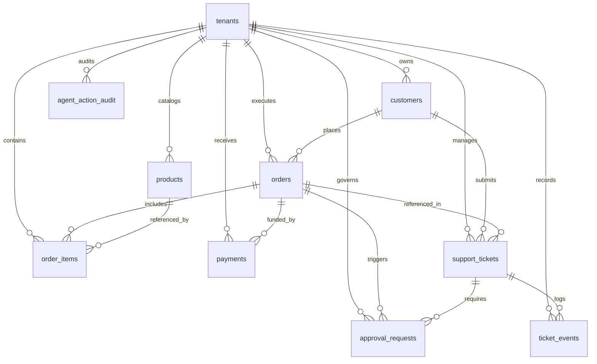

# Data Model Specification: Agentic ERP Customer Operations

## 1. Executive Summary & Architectural Overview
This document defines the PostgreSQL transactional data model (OLTP) for the **Agentic ERP Customer Operations Lab**. The schema models multi-tenant customer operations workflows—including customer account management, product catalogs, order processing, payments, customer support inquiries, Human-in-the-Loop (HITL) approval gates, and agent action audit trails.

The data model is engineered to satisfy three primary core requirements:
1. **Tenant Isolation**: Every domain entity includes a `tenant_id` foreign key referencing the `tenants` table to support row-level tenant partitioning and prevent cross-tenant leakage.
2. **Practical Change Data Capture (CDC)**: Every table possesses a explicit primary key (`UUID`), ensuring seamless real-time stream replication via Google Cloud Datastream (WAL capture) into Dataflow and BigQuery.
3. **Data Security & Privacy Safeguards**: Strict compliance with synthetic data policies (`AGENTS.md`). No live customer PII, credentials, API keys, or raw payment card details (PAN/CVV/tokens) are stored within the database.

---

## 2. Entity-Relationship Diagram (ERD)

---

## 3. Entities & Schema Specification

### 3.1 `tenants`
Organization/tenant boundary for multi-tenant isolation.

| Field Name | Type | Constraints | Description |
| :--- | :--- | :--- | :--- |
| `tenant_id` | UUID | PRIMARY KEY, DEFAULT gen_random_uuid() | Unique primary identifier for the tenant. |
| `name` | VARCHAR(255) | NOT NULL | Human-readable name of the tenant organization. |
| `slug` | VARCHAR(100) | NOT NULL, UNIQUE | URL-friendly unique identifier slug. |
| `status` | VARCHAR(50) | NOT NULL, DEFAULT 'active', CHECK (active, suspended, deactivated) | Operational state of the tenant. |
| `created_at` | TIMESTAMPTZ | NOT NULL, DEFAULT CURRENT_TIMESTAMP | Record creation timestamp. |
| `updated_at` | TIMESTAMPTZ | NOT NULL, DEFAULT CURRENT_TIMESTAMP | Record update timestamp. |

### 3.2 `customers`
Synthetic customer profiles owned by a tenant.

| Field Name | Type | Constraints | Description |
| :--- | :--- | :--- | :--- |
| `customer_id` | UUID | PRIMARY KEY, DEFAULT gen_random_uuid() | Unique primary identifier for the customer. |
| `tenant_id` | UUID | NOT NULL, FK -> tenants(tenant_id) | Tenant ownership reference. |
| `external_customer_ref` | VARCHAR(100) | NULLable | Legacy/external ERP reference code. |
| `first_name` | VARCHAR(100) | NOT NULL | Synthetic first name. |
| `last_name` | VARCHAR(100) | NOT NULL | Synthetic last name. |
| `email` | VARCHAR(255) | NOT NULL | Synthetic email address (uses example.com/org/net). |
| `phone_number` | VARCHAR(50) | NULLable | Synthetic phone number (+1-555-xxxx). |
| `company_name` | VARCHAR(255) | NULLable | Synthetic corporate entity name. |
| `status` | VARCHAR(50) | NOT NULL, DEFAULT 'active', CHECK (active, inactive, flagged) | Account status. |
| `created_at` | TIMESTAMPTZ | NOT NULL, DEFAULT CURRENT_TIMESTAMP | Record creation timestamp. |
| `updated_at` | TIMESTAMPTZ | NOT NULL, DEFAULT CURRENT_TIMESTAMP | Record update timestamp. |

*Unique Constraint*: `UNIQUE (tenant_id, email)`

### 3.3 `products`
Inventory catalog items offered by a tenant.

| Field Name | Type | Constraints | Description |
| :--- | :--- | :--- | :--- |
| `product_id` | UUID | PRIMARY KEY, DEFAULT gen_random_uuid() | Unique primary identifier for the product. |
| `tenant_id` | UUID | NOT NULL, FK -> tenants(tenant_id) | Tenant ownership reference. |
| `sku` | VARCHAR(100) | NOT NULL | Stock Keeping Unit code. |
| `name` | VARCHAR(255) | NOT NULL | Product title. |
| `description` | TEXT | NULLable | Detailed item specifications. |
| `unit_price` | NUMERIC(12,2) | NOT NULL, CHECK (unit_price >= 0) | Standard unit sale price. |
| `currency` | VARCHAR(3) | NOT NULL, DEFAULT 'USD' | ISO currency code. |
| `stock_quantity` | INT | NOT NULL, DEFAULT 0, CHECK (stock_quantity >= 0) | Real-time available inventory balance. |
| `status` | VARCHAR(50) | NOT NULL, DEFAULT 'active', CHECK (active, discontinued, out_of_stock) | Product catalog lifecycle status. |
| `created_at` | TIMESTAMPTZ | NOT NULL, DEFAULT CURRENT_TIMESTAMP | Record creation timestamp. |
| `updated_at` | TIMESTAMPTZ | NOT NULL, DEFAULT CURRENT_TIMESTAMP | Record update timestamp. |

*Unique Constraint*: `UNIQUE (tenant_id, sku)`

### 3.4 `orders`
Header table for customer purchase orders.

| Field Name | Type | Constraints | Description |
| :--- | :--- | :--- | :--- |
| `order_id` | UUID | PRIMARY KEY, DEFAULT gen_random_uuid() | Unique primary identifier for the order. |
| `tenant_id` | UUID | NOT NULL, FK -> tenants(tenant_id) | Tenant ownership reference. |
| `customer_id` | UUID | NOT NULL, FK -> customers(customer_id) | Customer account reference. |
| `order_number` | VARCHAR(100) | NOT NULL | Human-readable order tracking code. |
| `order_status` | VARCHAR(50) | NOT NULL, CHECK (pending, processing, shipped, delivered, cancelled, late, returned) | Order lifecycle state. |
| `total_amount` | NUMERIC(12,2) | NOT NULL, CHECK (total_amount >= 0) | Aggregate order transaction total. |
| `currency` | VARCHAR(3) | NOT NULL, DEFAULT 'USD' | ISO currency code. |
| `shipping_address_masked` | TEXT | NULLable | Masked non-sensitive synthetic delivery address. |
| `ordered_at` | TIMESTAMPTZ | NOT NULL, DEFAULT CURRENT_TIMESTAMP | Order placement timestamp. |
| `promised_delivery_at` | TIMESTAMPTZ | NULLable | SLA delivery deadline timestamp. |
| `created_at` | TIMESTAMPTZ | NOT NULL, DEFAULT CURRENT_TIMESTAMP | Record creation timestamp. |
| `updated_at` | TIMESTAMPTZ | NOT NULL, DEFAULT CURRENT_TIMESTAMP | Record update timestamp. |

*Unique Constraint*: `UNIQUE (tenant_id, order_number)`

### 3.5 `order_items`
Individual line items attached to orders.

| Field Name | Type | Constraints | Description |
| :--- | :--- | :--- | :--- |
| `order_item_id` | UUID | PRIMARY KEY, DEFAULT gen_random_uuid() | Unique line item primary identifier. |
| `tenant_id` | UUID | NOT NULL, FK -> tenants(tenant_id) | Tenant ownership reference. |
| `order_id` | UUID | NOT NULL, FK -> orders(order_id) | Parent purchase order reference. |
| `product_id` | UUID | NOT NULL, FK -> products(product_id) | Purchased product item reference. |
| `quantity` | INT | NOT NULL, CHECK (quantity > 0) | Purchased quantity count. |
| `unit_price` | NUMERIC(12,2) | NOT NULL, CHECK (unit_price >= 0) | Price per item at purchase time. |
| `subtotal` | NUMERIC(12,2) | NOT NULL, CHECK (subtotal >= 0) | Calculated line subtotal (`quantity * unit_price`). |
| `created_at` | TIMESTAMPTZ | NOT NULL, DEFAULT CURRENT_TIMESTAMP | Record creation timestamp. |
| `updated_at` | TIMESTAMPTZ | NOT NULL, DEFAULT CURRENT_TIMESTAMP | Record update timestamp. |

### 3.6 `payments`
Financial transaction receipts associated with orders.

| Field Name | Type | Constraints | Description |
| :--- | :--- | :--- | :--- |
| `payment_id` | UUID | PRIMARY KEY, DEFAULT gen_random_uuid() | Unique payment record primary identifier. |
| `tenant_id` | UUID | NOT NULL, FK -> tenants(tenant_id) | Tenant ownership reference. |
| `order_id` | UUID | NOT NULL, FK -> orders(order_id) | Target purchase order reference. |
| `payment_reference` | VARCHAR(100) | NOT NULL | Synthetic gateway payment reference code. |
| `payment_method` | VARCHAR(50) | NOT NULL, CHECK (credit_card, bank_transfer, purchase_order, store_credit) | Synthetic payment method category. |
| `payment_status` | VARCHAR(50) | NOT NULL, CHECK (pending, completed, failed, refunded, partially_refunded) | Processing status of payment transaction. |
| `amount` | NUMERIC(12,2) | NOT NULL, CHECK (amount >= 0) | Payment amount processed. |
| `currency` | VARCHAR(3) | NOT NULL, DEFAULT 'USD' | ISO currency code. |
| `processed_at` | TIMESTAMPTZ | NULLable | Gateway processing completion timestamp. |
| `created_at` | TIMESTAMPTZ | NOT NULL, DEFAULT CURRENT_TIMESTAMP | Record creation timestamp. |
| `updated_at` | TIMESTAMPTZ | NOT NULL, DEFAULT CURRENT_TIMESTAMP | Record update timestamp. |

### 3.7 `support_tickets`
Customer service tickets managed by agents and support staff.

| Field Name | Type | Constraints | Description |
| :--- | :--- | :--- | :--- |
| `support_ticket_id` | UUID | PRIMARY KEY, DEFAULT gen_random_uuid() | Unique support ticket primary identifier. |
| `tenant_id` | UUID | NOT NULL, FK -> tenants(tenant_id) | Tenant ownership reference. |
| `customer_id` | UUID | NOT NULL, FK -> customers(customer_id) | Submitting customer reference. |
| `order_id` | UUID | NULLable, FK -> orders(order_id) | Optional related order reference. |
| `ticket_number` | VARCHAR(100) | NOT NULL | Human-readable ticket reference code. |
| `subject` | VARCHAR(255) | NOT NULL | Ingestion summary / title of inquiry. |
| `priority` | VARCHAR(50) | NOT NULL, CHECK (low, normal, high, urgent) | Ticket urgency level. |
| `status` | VARCHAR(50) | NOT NULL, CHECK (open, pending, resolved, closed, rejected) | Current resolution state. |
| `category` | VARCHAR(50) | NOT NULL, CHECK (order_status, billing, refund_request, product_inquiry, general) | Classification topic. |
| `created_at` | TIMESTAMPTZ | NOT NULL, DEFAULT CURRENT_TIMESTAMP | Record creation timestamp. |
| `updated_at` | TIMESTAMPTZ | NOT NULL, DEFAULT CURRENT_TIMESTAMP | Record update timestamp. |

*Unique Constraint*: `UNIQUE (tenant_id, ticket_number)`

### 3.8 `ticket_events`
Chronological message history and system actions on tickets.

| Field Name | Type | Constraints | Description |
| :--- | :--- | :--- | :--- |
| `ticket_event_id` | UUID | PRIMARY KEY, DEFAULT gen_random_uuid() | Unique event record primary identifier. |
| `tenant_id` | UUID | NOT NULL, FK -> tenants(tenant_id) | Tenant ownership reference. |
| `support_ticket_id` | UUID | NOT NULL, FK -> support_tickets(support_ticket_id) | Target ticket reference. |
| `actor_type` VARCHAR(50) | NOT NULL, CHECK (customer, human_agent, ai_agent, system) | Entity originating event. |
| `actor_id` | VARCHAR(100) | NOT NULL | Identifier of originating actor. |
| `event_type` | VARCHAR(50) | NOT NULL, CHECK (created, comment_added, status_changed, priority_changed, assigned) | Classification of ticket activity. |
| `message_body` | TEXT | NOT NULL | Event log or message content. |
| `created_at` | TIMESTAMPTZ | NOT NULL, DEFAULT CURRENT_TIMESTAMP | Timestamp of activity. |

### 3.9 `approval_requests`
Human-in-the-Loop (HITL) approval tracking table.

| Field Name | Type | Constraints | Description |
| :--- | :--- | :--- | :--- |
| `approval_request_id` | UUID | PRIMARY KEY, DEFAULT gen_random_uuid() | Unique approval primary identifier. |
| `tenant_id` | UUID | NOT NULL, FK -> tenants(tenant_id) | Tenant ownership reference. |
| `support_ticket_id` | UUID | NULLable, FK -> support_tickets(support_ticket_id) | Associated support ticket reference. |
| `order_id` | UUID | NULLable, FK -> orders(order_id) | Associated order reference. |
| `request_type` | VARCHAR(50) | NOT NULL, CHECK (refund_processing, address_change, discount_override, order_cancellation) | Categorized HITL operation type. |
| `requested_by_agent` | VARCHAR(100) | NOT NULL | Subagent ID requesting action execution. |
| `approver_id` | VARCHAR(100) | NULLable | Human operator ID resolving request. |
| `status` | VARCHAR(50) | NOT NULL, CHECK (pending, approved, rejected, cancelled) | Authorization workflow state. |
| `proposed_action_payload` | JSONB | NOT NULL | Structured parameters for proposed mutation. |
| `reason` | TEXT | NULLable | Operator decision note / policy rule context. |
| `decided_at` | TIMESTAMPTZ | NULLable | Authorization decision timestamp. |
| `created_at` | TIMESTAMPTZ | NOT NULL, DEFAULT CURRENT_TIMESTAMP | Request submission timestamp. |
| `updated_at` | TIMESTAMPTZ | NOT NULL, DEFAULT CURRENT_TIMESTAMP | Request status update timestamp. |

### 3.10 `agent_action_audit`
Immutable execution log for all AI subagent tool invocations.

| Field Name | Type | Constraints | Description |
| :--- | :--- | :--- | :--- |
| `agent_action_audit_id` | UUID | PRIMARY KEY, DEFAULT gen_random_uuid() | Unique audit record primary identifier. |
| `tenant_id` | UUID | NOT NULL, FK -> tenants(tenant_id) | Tenant ownership reference. |
| `agent_id` | VARCHAR(100) | NOT NULL | Subagent instance identifier. |
| `agent_role` | VARCHAR(100) | NOT NULL | Subagent role (supervisor, refund_agent, etc.). |
| `action_name` | VARCHAR(100) | NOT NULL | Executed tool call name. |
| `target_entity_type` | VARCHAR(50) | NOT NULL | Target domain entity name (e.g. orders). |
| `target_entity_id` | VARCHAR(100) | NOT NULL | Target domain entity primary key. |
| `execution_status` | VARCHAR(50) | NOT NULL, CHECK (initiated, completed, failed, blocked_hitl) | Outcome of tool invocation. |
| `input_parameters` | JSONB | NULLable | Tool invocation arguments payload. |
| `output_result` | JSONB | NULLable | Tool invocation output payload. |
| `error_message` | TEXT | NULLable | Error exception message if failed/blocked. |
| `created_at` | TIMESTAMPTZ | NOT NULL, DEFAULT CURRENT_TIMESTAMP | Action execution timestamp. |

---

## 4. Sensitive Fields & Security Guidelines

### 4.1 Prohibited Sensitive Data
In strict accordance with project rules (`AGENTS.md`), the following categories of sensitive data **MUST NEVER** be created, stored, ingested, or committed:
- **Payment Card Data**: Credit/debit card numbers (PAN), CVVs, expiration dates, or payment gateway authentication tokens.
- **Service & Infrastructure Credentials**: GCP service account keys, passwords, database user credentials, or API secret keys.
- **Real PII**: Live customer email addresses, real names, phone numbers, or physical street addresses.

### 4.2 Handling Synthetic Data & Masking
- All customer email addresses must use standard reserved documentation domains (`example.com`, `example.org`, `example.net`).
- Physical addresses are stored in a synthetic masked format (`shipping_address_masked`) preventing storage of precise unmasked location data.
- Financial transaction IDs use obviously fictional synthetic formats (`PAY-SYNTH-xxxx`).

---

## 5. Data Retention & Archival Considerations

### 5.1 OLTP Storage Retention
- **Operational Data (`orders`, `payments`, `support_tickets`)**: Retained in Cloud SQL PostgreSQL for 90 days active operational window to minimize OLTP storage footprint.
- **Audit & History (`ticket_events`, `agent_action_audit`)**: Active OLTP table retention set to 30 days. Historical log events older than 30 days are automatically archived to BigQuery via CDC.

### 5.2 Archival Strategy
- PostgreSQL WAL stream CDC automatically replicates all inserts, updates, and deletes to BigQuery.
- In BigQuery, tables are configured as append-only partitioned tables, preserving full immutable historical audit logs indefinitely without burdening Cloud SQL disk storage.

---

## 6. CDC Behavior & Datastream Integration

### 6.1 Change Data Capture (CDC) Architecture
- **Primary Keys**: Every replicated PostgreSQL table includes an explicit primary key (`UUID`). This requirement is mandatory for Google Cloud Datastream to track row-level mutations (INSERT, UPDATE, DELETE) using PostgreSQL Write-Ahead Logging (WAL) via `pgoutput`.
- **Idempotency & Re-playability**: Downstream processing pipelines (Dataflow) consume Datastream CDC events using primary key + `updated_at` ordering to guarantee idempotent upserts into BigQuery target tables.
- **Tombstone Handling**: Hard deletes in PostgreSQL emit CDC delete events containing the row primary key and `tenant_id`, allowing BigQuery target views to softly mark records as deleted without losing historical record traces.

---

## 7. Intended BigQuery Analytical Destinations

Below is the mapping of transactional PostgreSQL tables to target BigQuery lakehouse datasets and partitioning strategies:

| PostgreSQL Source Table | BigQuery Target Table | Partition Key | Clustering Keys |
| :--- | :--- | :--- | :--- |
| `tenants` | `erp_analytics_dev.raw_tenants` | `created_at` (Day) | `tenant_id`, `status` |
| `customers` | `erp_analytics_dev.raw_customers` | `created_at` (Day) | `tenant_id`, `status` |
| `products` | `erp_analytics_dev.raw_products` | `created_at` (Day) | `tenant_id`, `sku` |
| `orders` | `erp_analytics_dev.raw_orders` | `ordered_at` (Day) | `tenant_id`, `order_status` |
| `order_items` | `erp_analytics_dev.raw_order_items` | `created_at` (Day) | `tenant_id`, `order_id` |
| `payments` | `erp_analytics_dev.raw_payments` | `created_at` (Day) | `tenant_id`, `payment_status` |
| `support_tickets` | `erp_analytics_dev.raw_support_tickets` | `created_at` (Day) | `tenant_id`, `status`, `priority` |
| `ticket_events` | `erp_analytics_dev.raw_ticket_events` | `created_at` (Day) | `tenant_id`, `support_ticket_id` |
| `approval_requests` | `erp_analytics_dev.raw_approval_requests` | `created_at` (Day) | `tenant_id`, `status` |
| `agent_action_audit` | `agent_evaluation_dev.raw_agent_action_audit` | `created_at` (Day) | `tenant_id`, `agent_id`, `execution_status` |
