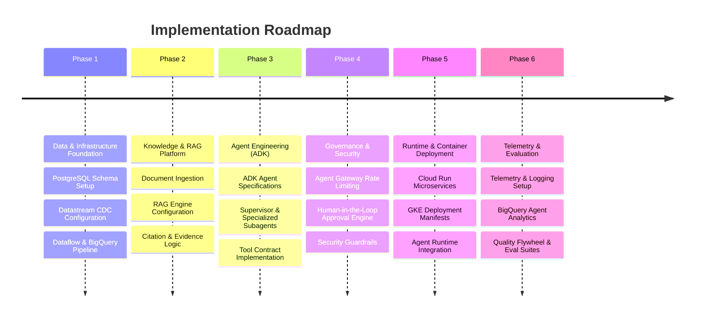

# Project Charter: Agentic ERP Customer Operations Lab

## 1. Executive Summary & Use Case
The **Agentic ERP Customer Operations Lab** is an enterprise AI engineering lab designed to build, evaluate, and operate autonomous and semi-autonomous AI agents within Enterprise Resource Planning (ERP) customer workflows on Google Cloud Platform (GCP) using the **Gemini Enterprise Agent Platform**.

### Synthetic Customer Operations Use Case
The lab simulates end-to-end customer operations scenarios using strictly synthetic enterprise data:
- **Customer Inquiry Resolution**: Answering account, billing, and product inquiries with grounded knowledge retrieval.
- **Order Status Verification**: Querying real-time transactional database states to report order tracking, fulfillment, and shipment status.
- **Inventory Availability Checks**: Verifying stock levels across synthetic distribution centers.
- **Customer Profile Updates**: Handling requests to modify customer account details (subject to governance).
- **Refund & Adjustment Processing**: Evaluating refund requests and routing them through mandatory Human-in-the-Loop (HITL) approval gates.

---

## 2. Status & Work Tracking: Completed vs. Planned

> [!IMPORTANT]
> **Current Status**: **Day 1 Foundation**. The repository structure, core agent rules, and baseline documentation are established. All active pipeline components, databases, runtimes, and agent services represent **Planned Work**.

| Domain / Component | Status | Implementation Details |
| :--- | :--- | :--- |
| **Repository Structure & Specs** | **Completed** | Directory layout created (`app/`, `docs/`, `infra/`, `scripts/`, `specs/`, `tests/`). `AGENTS.md` and initial `README.md` established. |
| **Agent Governance Rules** | **Completed** | Core principles defined in `AGENTS.md` (synthetic data, credentials protection, HITL, RAG citation rules, `dev` / `us-central1` defaults). |
| **Transactional Data (PostgreSQL)** | **Planned** | OLTP schema design, synthetic ERP customer/order dataset generation, Cloud SQL / PostgreSQL deployment. |
| **CDC Pipeline (Datastream & Dataflow)** | **Planned** | PostgreSQL WAL replication via Datastream to Cloud Storage/PubSub, streaming transformation via Dataflow into BigQuery. |
| **Analytics & Eval Lakehouse (BigQuery)** | **Planned** | BigQuery dataset provisioning for operational analytics, CDC target tables, and Agent Analytics evaluation logs. |
| **RAG Knowledge Engine** | **Planned** | RAG Engine provisioning, ERP documentation/policy ingestion, semantic index creation, citation enforcement. |
| **Multi-Agent Systems (ADK)** | **Planned** | Agent Development Kit (ADK) agent definition, supervisor/subagent orchestration, tool contract specifications. |
| **Execution & Gateways (Runtime/Gateway)**| **Planned** | Agent Runtime container hosting, Agent Gateway API routing, rate limiting, and policy enforcement. |
| **Infrastructure & Hosting (Cloud Run/GKE)**| **Planned** | Cloud Run microservice deployment, GKE cluster provisioning for scalable agent workloads, Terraform IaC. |
| **Observability & Eval Suite** | **Planned** | Telemetry integration (Cloud Trace, token usage, latency), Quality Flywheel evaluation datasets, LLM-as-judge test suites. |

---

## 3. In-Scope and Out-of-Scope Capabilities

### In-Scope Capabilities
- **Synthetic Data Processing**: Full end-to-end operation using generated, non-PII ERP data stores.
- **CDC Data Ingestion**: Real-time replication from PostgreSQL to BigQuery via Datastream and Dataflow.
- **Agent Development Kit (ADK) Workflows**: Structuring specialized subagents (e.g., Order Resolution Agent, Profile Management Agent, Refund Agent) using ADK patterns.
- **RAG Integration**: Grounding agent responses with policy documents and knowledge bases while enforcing evidence preservation and citation rules.
- **Human-in-the-Loop (HITL) Controls**: Mandatory human authorization steps for sensitive state changes (refunds, notifications, profile updates).
- **Enterprise Gateways & Runtimes**: Agent Gateway management (rate limiting, request routing, security policy) and secure execution in Agent Runtime, Cloud Run, and GKE.
- **Telemetry & Quality Flywheel**: Recording token usage, latency, tool calls, and automated evaluation metrics (LLM-as-judge) without exposing secrets or sensitive data.

### Out-of-Scope Capabilities
- **Real Customer Data / PII**: Ingesting, storing, or processing real customer records or live enterprise database connections.
- **Unapproved Financial / State Mutations**: Executing refunds, updating customer data, or dispatching external notifications without explicit HITL approval.
- **Automatic Destructive Execution**: Executing destructive database or cloud commands (e.g., `DROP TABLE`, `TRUNCATE`, unconstrained `DELETE`, or project deletion).
- **Credentials & Secret Storage**: Committing service-account keys, `.env` files, database dumps, or Terraform state files to source control.
- **Multi-Region / Non-Dev Deployments**: Deploying production workloads outside the `dev` environment or target region (`us-central1`) without prior specification approval.

---

## 4. Planned Data Pipeline (PostgreSQL to BigQuery)

```mermaid
flowchart LR
    A[Cloud SQL PostgreSQL\n(OLTP Transactional Store)] -->|CDC / WAL| B[Datastream\n(Serverless Replication)]
    B -->|Streaming CDC Events| C[Dataflow\n(Stream Transformation)]
    C -->|Real-Time Writes| D[BigQuery Lakehouse\n(Analytics & Agent Logs)]
    D -->|Context & Analytics| E[Agent Runtime & ADK Agents]
```

### Architectural Pipeline Components
1. **Cloud SQL for PostgreSQL**: Serves as the primary transactional OLTP database holding synthetic ERP entities (customers, orders, inventory, billing ledger).
2. **Datastream**: Serverless Change Data Capture (CDC) service capturing row-level changes from PostgreSQL write-ahead logs (WAL) in real time with minimal operational impact.
3. **Dataflow**: Managed Apache Beam stream-processing engine performing schema transformation, data enrichment, and windowed aggregation before loading CDC events.
4. **BigQuery**: Enterprise analytical lakehouse storing replicated ERP tables for analytical queries, audit logs, and agent evaluation telemetry via BigQuery Agent Analytics.

---

## 5. Agent Architecture: RAG, Orchestration, Approvals, & Guardrails

### RAG (Retrieval-Augmented Generation) Engine
- Uses Google Cloud RAG capabilities to index ERP operational manuals, return policies, and product documentation.
- **Strict Evidence Rule**: Agents must preserve RAG citations in responses and explicitly report insufficient evidence when knowledge base lookups yield incomplete information.

### Multi-Agent Orchestration (ADK)
- Built using the **Agent Development Kit (ADK)** framework.
- Uses a **Supervisor-Worker Pattern**:
  - **Supervisor Agent**: Parses incoming customer inquiries, determines intent, delegates to specialized subagents, and synthesizes final responses.
  - **Order Status Subagent**: Interfaces with PostgreSQL and BigQuery tools to query fulfillment state.
  - **Customer Profile Subagent**: Manages profile update workflows under strict validation rules.
  - **Refund Processing Subagent**: Calculates eligibility and constructs refund proposals requiring human approval.

### Human-in-the-Loop (HITL) Approvals
- Operations classified as high-risk (financial refunds, sending customer notifications, modifying account records) trigger an asynchronous HITL workflow.
- Agents generate proposed action payloads and pause execution until authorized by an operator through the Agent Gateway / UI control plane.

### Agent Guardrails & Safety
- **Content Trust**: External retrieved documents and user inputs are handled as untrusted data.
- **Least-Privilege Identities**: All service-to-service calls authenticate via Application Default Credentials (ADC) and IAM least-privilege roles.
- **Execution Safety**: Strict prohibition against destructive queries or automatic system state modification without approval.

---

## 6. Hosting & Infrastructure Objectives: Agent Runtime, Cloud Run, & GKE

```mermaid
flowchart TD
    Client[Client / Integration Request] --> Gateway[Agent Gateway\n(API Routing, Rate Limiting, Security)]
    Gateway --> Runtime[Agent Runtime\n(ADK Agent Execution Layer)]
    Gateway --> CloudRun[Cloud Run Microservices\n(Webhooks & Light APIs)]
    Gateway --> GKE[GKE Cluster\n(Scalable Agent Workloads & Services)]
    Runtime --> RAG[RAG Engine]
    Runtime --> Data[PostgreSQL / BigQuery]
```

1. **Agent Runtime**: Secure, managed execution layer hosting ADK agents, managing subagent lifecycles, and executing tool calls safely.
2. **Agent Gateway**: Centralized entry point providing request routing, authentication, enterprise security policy enforcement, and API rate limiting across services.
3. **Cloud Run**: Serverless container hosting for lightweight microservices, webhook receivers, and API adapters requiring auto-scaling to zero.
4. **GKE (Google Kubernetes Engine)**: Managed Kubernetes cluster providing dedicated compute, fine-grained container orchestration, and high-throughput scaling for enterprise agent workloads and backend services.

---

## 7. Observability, Rate Limiting, Testing, & Evaluation Goals

### Observability & Telemetry
- Integration with Cloud Trace, Cloud Logging, and **BigQuery Agent Analytics**.
- Metrics recorded per interaction: token consumption (input/output tokens), execution latency, tool call sequences, model parameters, and error rates.
- Strict compliance with `AGENTS.md`: Telemetry must never record sensitive content or credentials.

### Rate Limiting & Quota Management
- Configured at the **Agent Gateway** to enforce request-per-minute (RPM) and token-per-minute (TPM) limits per client and per subagent.
- Protects downstream Gemini API quotas and prevents budget overruns.

### Testing & Evaluation Framework (Quality Flywheel)
- **Unit Testing**: Testing tool execution functions, schema parsing, and individual subagent logic.
- **Integration Testing**: End-to-end testing of PostgreSQL-to-BigQuery pipelines, Agent Gateway routing, and RAG retrieval.
- **Security Testing**: Prompt injection resistance, credential leakage checks, and unauthorized operation blocking.
- **Agent Evaluation**: Quality Flywheel methodology utilizing LLM-as-judge scoring on evaluation datasets stored in BigQuery to assess goal completion, citation accuracy, and policy adherence.

---

## 8. Security & Cost Constraints

### Security Constraints
- **Synthetic Data Mandatory**: No real PII or proprietary operational data.
- **No Hardcoded Credentials**: Service account keys, API tokens, `.env` files, database dumps, or Terraform state files must never be created, displayed, or committed.
- **Identity & Access Management**: Use Application Default Credentials (ADC) and fine-grained GCP IAM roles.
- **Infrastructure Change Control**: Cloud resource, IAM, network, database, and deployment changes require explicit approval before execution.

### Cost Constraints
- **Default Scope**: Deployment target limited to `dev` environment in `us-central1`.
- **Resource Management**: Datastream, Dataflow, Cloud SQL, Cloud Run, and GKE cluster configurations must include autoscaling limits and shutdown parameters to prevent unnecessary GCP billing.

---

## 9. Measurable Completion Criteria

The project phases will be deemed complete when the following criteria are verified:

1. **Pipeline Latency**: PostgreSQL CDC changes replicate through Datastream and Dataflow into BigQuery within target SLA (< 30 seconds end-to-end latency).
2. **Knowledge Accuracy**: RAG Engine achieves >= 95% citation accuracy on benchmark ERP policy evaluation datasets.
3. **HITL Enforceability**: 100% of sensitive operations (refunds, profile modifications, outbound communications) trigger mandatory HITL approval blocks without bypass.
4. **Evaluation Benchmark**: ADK agent suite achieves >= 90% pass rate on Quality Flywheel evaluation test suites (task completion, correctness, policy compliance).
5. **Zero Security Findings**: Automated repository security scans confirm 0 committed credentials, secrets, `.env` files, or unmasked PII.
6. **Deployability**: Microservices and Agent Runtime components successfully build, pass test suites, and deploy cleanly to Cloud Run and GKE via automated workflows.

---

## 10. Phased Implementation Order



### Phase 1: Data & Infrastructure Foundation
- Design PostgreSQL schema for synthetic ERP customer operations.
- Generate synthetic customer, order, and inventory datasets.
- Provision Datastream CDC, Dataflow stream processing, and BigQuery target datasets.

### Phase 2: Knowledge & RAG Platform
- Ingest synthetic ERP operational guides, policy manuals, and FAQs.
- Configure Google Cloud RAG Engine and index domain documents.
- Implement evidence evaluation and citation verification rules in retrieval tools.

### Phase 3: Agent Engineering (ADK)
- Implement ADK supervisor agent and specialized subagents (Order Resolution, Profile Management, Refund Processing).
- Define formal OpenAPI / spec contracts for agent tools in `specs/`.
- Validate tool calling against synthetic PostgreSQL and RAG endpoints.

### Phase 4: Governance & Security
- Deploy Agent Gateway with request routing, security policy enforcement, and rate limiting.
- Implement HITL workflow engine for asynchronous human authorization of sensitive actions.
- Conduct security testing for prompt injection and authorization boundary enforcement.

### Phase 5: Runtime & Container Deployment
- Containerize microservices and deploy to Cloud Run.
- Configure GKE cluster manifests for agent workloads and backend services.
- Establish Agent Runtime environment for secure agent execution.

### Phase 6: Telemetry, Evaluation, & Hardening
- Implement telemetry logging (token usage, latency, tool calls) to BigQuery Agent Analytics.
- Build evaluation datasets and run LLM-as-judge benchmark evaluation suites.
- Perform end-to-end verification, optimization, and documentation finalization.
